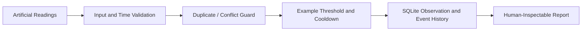

# QE Alerts — Event Processing Showcase

[](https://github.com/TheMan10101/qe-alerts-engineering-showcase/actions/workflows/python-tests.yml)

**Public, standalone Python + SQLite demonstration of event-processing reliability.** The full QE Alerts monitoring and mobile-notification application remains private.

The independent QE Alerts project involves reviewing AI-assisted development of time-series monitoring, configurable events, deduplication, cooldown behavior, SQLite event history, and a phone-accessible alert feed. This repository is a deliberately smaller, **synthetic** implementation that can be run and tested without network access or any production services.

## Inspectable demonstration

| File | What it proves |
| --- | --- |
| [`demo_event_monitor.py`](demo_event_monitor.py) | Ordered sample processing, configurable threshold and cooldown, exact-duplicate suppression, conflict rejection, UTC-normalized timestamps, SQLite storage |
| [`test_demo_event_monitor.py`](test_demo_event_monitor.py) | Automated edge-case testing for thresholds, duplicates, conflict detection, out-of-order input, invalid data, cooldown boundaries, and persisted state |
| [GitHub Actions](.github/workflows/python-tests.yml) | Runs the public synthetic demonstration and unit tests on changes |

### Quick start

Python 3.12 or newer, no third-party packages:

```bash
python demo_event_monitor.py
python -m unittest discover -v
```

Example output (synthetic input; arbitrary demonstration threshold, **not a trading alert rule**):

```json
{
  "synthetic": true,
  "input_records": 5,
  "alerts_emitted": 2,
  "stored_events": [
    {"timestamp": "2026-01-01T00:01:00.000000+00:00", "value": 84.0},
    {"timestamp": "2026-01-01T00:12:00.000000+00:00", "value": 90.0}
  ]
}
```

The example includes one reading below the threshold, an exact duplicate, a suppressed event inside the cooldown, and two events that are stored.

## Engineering decisions illustrated

1. **Treat duplicates and conflicts differently.** Replaying an identical observation does not produce another alert. Replaying the same timestamp with a different value raises an explicit error rather than silently taking either value.
2. **Normalize time before detecting duplicates.** Two time-zone representations of the same instant map to one UTC timestamp.
3. **Validate before changing state.** Nonfinite values, nonnumeric inputs and timestamp ordering errors are rejected before committing a new observation. SQLite uses a transaction so a failure inserting an event rolls back the observation too.
4. **Persist and recover cooldown state.** The default SQLite database is `:memory:` for a clean demo. Passing a file path stores both observations and emitted events so a new instance can recover history and uphold cooldown rules. An automated test opens, closes, then reopens the database to check this.
5. **Reject mismatched configuration on restart.** A file-backed database records its demonstration threshold and cooldown; reopening with a different policy fails instead of silently changing interpretation.
6. **Keep the public system intentionally bounded.** The example *records* an emitted event in SQLite; it does not send phone notifications, execute trades, or call a real service.

These are the choices implemented in **this public sample**, not disclosures of proprietary QE Alerts event rules or production configuration.

## Conceptual workflow



## My role and technology boundaries

I direct the requirements and review of AI-assisted development, emphasizing alert quality, reproducible tests, human approval, and validation of adverse cases. I use Claude Code and OpenAI Codex as daily development tools, with human review of generated code and test results.

- **Demonstrated by public files:** Python, `sqlite3`, `unittest`, GitHub Actions, ordered event processing and restart-aware persistence.
- **Broader private system, not reproduced here:** time-series indicators, a phone-accessible alert feed, audible severity-based notifications, and operational monitoring. The public test suite does **not** verify those private features.
- **Not provided here:** real market feeds, proprietary thresholds, push delivery, websocket connections, hosted deployment, or strategy/execution code.

## Limitations

The demo assumes one process and in-order observations. It deliberately fails closed on out-of-order input rather than implementing a late-arrival buffer. It does not establish durability under concurrent writers, exactly-once delivery across a network, or phone-notification reliability. File-backed SQLite is optional; the default run uses an ephemeral in-memory database.

## Confidentiality

All thresholds and values shown here are invented examples. This repository excludes private source code, account information, credentials, API keys, strategy logic, internal URLs, production datasets, and private infrastructure.
